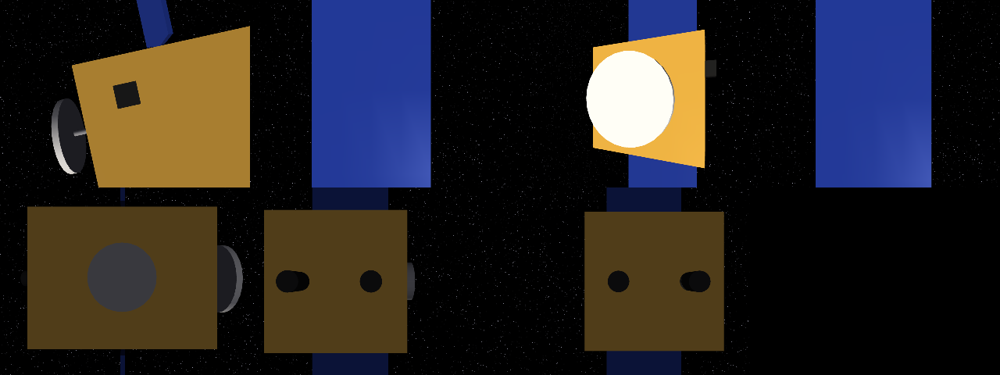
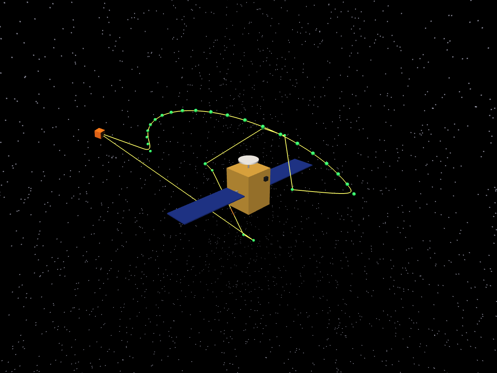
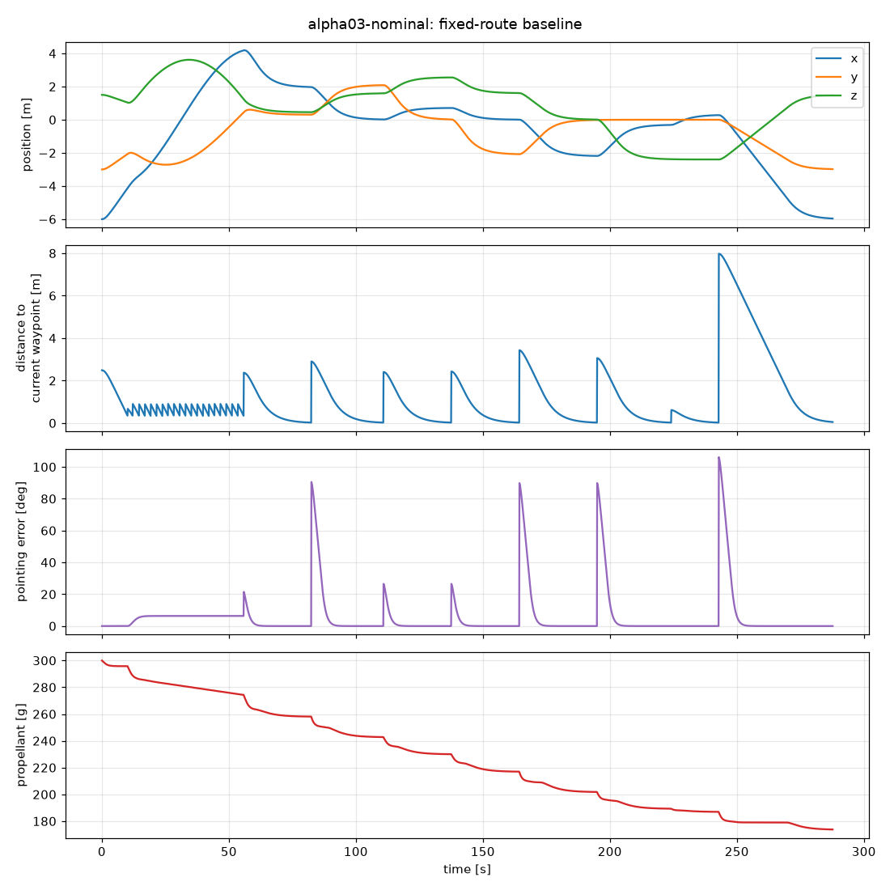

# space-autonomy

A simulation and evaluation testbed for autonomous space robots, starting with one job:
**a free-flying robot inspecting a spacecraft.**


*Left: the inspector (orange cube) flying its route around the target spacecraft Alpha-03. Right: what its onboard camera sees.*

The long-term question this project is built to answer is not "can a robot fly a route?" but
**"how does an autonomous system behave when the world stops behaving as expected?"** —
sensor failures, unexpected obstacles, thruster faults, unfamiliar spacecraft. That needs
three things working together: a simulated environment, an autonomy stack, and an
evaluation harness that measures what actually happened. This repo has the first working
version of all three.

## Status

| Milestone | What | State |
|---|---|---|
| M0 | MuJoCo installed, physics + rendering verified | ✅ |
| M1 | 6-DOF free-flyer flies itself to position + attitude targets | ✅ |
| M2 | Primitive target spacecraft (Alpha-03), robot positioned around it | ✅ |
| M3–M5 | Robot near spacecraft, onboard camera, fixed inspection route | ✅ (early) |
| M6 | Anomaly detection | next |
| M7–M9 | Choose what to inspect next, unexpected obstacle, autonomous recovery | |
| M10–M11 | Randomised missions, mission scoring at scale | harness started |
| M12+ | Learned perception / planning, ROS 2, Isaac Sim | |

## Baseline 1 result: fixed-route inspection

```
MISSION REPORT
────────────────────────────────────────
Mission:               alpha03-nominal
Mission success:       YES
Targets inspected:     7 / 7
Mission time:          288 s
Propellant used:       126 g (42.1%)
Delta-v spent:         7.05 m/s
Distance flown:        38.6 m
Collisions:            0
Min clearance:         0.45 m
Human interventions:   0
```

Onboard camera at each of the 7 inspection viewpoints (star tracker, both solar panels,
antenna, docking port, both thrusters):



| Overview with planned waypoints (green) and flown path | Telemetry |
|---|---|
|  |  |

This is deliberately the *dumbest* system that works. It is the yardstick every smarter
system will be compared against.

## Quick start

macOS / Linux, Python 3.10+:

```bash
python3 -m venv .venv
source .venv/bin/activate
pip install -e ".[dev]"

python scripts/m0_smoke.py              # is MuJoCo working?
python scripts/m1_goto.py               # free-flyer flies to 4 pose targets
python scripts/run_mission.py --gif     # full inspection mission -> results/alpha03-nominal/
mjpython scripts/run_mission.py --viewer  # watch it live (macOS needs `mjpython`, ships with MuJoCo)
pytest
```

Every mission run writes `telemetry.csv` (10 Hz state log), `events.json`, `summary.json`,
`report.txt`, plots, and onboard camera images to `results/<mission>/`.

## How it works

```
                 ┌──────────────── autonomy (pure NumPy, no simulator imports) ────────────────┐
RobotState ───▶  │  LegSequencer ──▶ target pose ──▶ PoseController ──▶ Wrench (body frame)     │ ───▶ Wrench
                 │  (mission executive)               (cascaded control)                       │
                 └─────────────────────────────────────────────────────────────────────────────┘
     ▲                                                                                               │
     │            ┌──────────────────────────── simulator (MuJoCo) ─────────────────────────────┐    │
     └─────────── │  free-flying rigid body  ◀── ThrusterModel (limits, propellant burn) ◀───────│ ◀──┘
                  └──────────────────────────────────────────────────────────────────────────────┘
                        ▲ the harness runs this loop at 20 Hz and records ground truth ▲
```

**The one architectural rule:** the autonomy code never imports MuJoCo. It receives a
`RobotState` (position, orientation, velocity, spin rate) and returns a `Wrench` (force and
torque in the robot's body frame). That contract lives in
[`core/types.py`](space_autonomy/core/types.py). Porting to Isaac Sim, or to a ROS 2 node, or
to hardware, means re-implementing only the simulator side.

### The pieces

| Module | What it does |
|---|---|
| [`sim/world.py`](space_autonomy/sim/world.py) | Builds the MuJoCo scene: zero gravity, a starfield, a sun, the spacecraft, and the robot (a 10 kg, 0.3 m cube on a free joint, with a camera on its +x face). |
| [`sim/thrusters.py`](space_autonomy/sim/thrusters.py) | Caps force at 1 N and torque at 0.1 N·m per axis; burns propellant at `thrust / (Isp · g0)` with cold-gas Isp = 60 s. |
| [`sim/spacecraft.py`](space_autonomy/sim/spacecraft.py) | A spacecraft is a list of primitive components. The same list generates the MuJoCo geometry *and* the obstacle boxes + inspection targets the autonomy plans with. |
| [`controllers/pose_controller.py`](space_autonomy/controllers/pose_controller.py) | Cascaded controller: position error → desired velocity (capped at 0.25 m/s) → force. Same idea for attitude. |
| [`planning/paths.py`](space_autonomy/planning/paths.py) | Fly straight if it's safe; otherwise back out to a keep-out sphere, go around it, come back in. |
| [`planning/sequencer.py`](space_autonomy/planning/sequencer.py) | Executes legs: fly through waypoints, settle, point the camera, hold, next. |
| [`planning/inspection_planner.py`](space_autonomy/planning/inspection_planner.py) | Baseline 1: a fixed visiting order turned into legs. |
| [`evaluation/harness.py`](space_autonomy/evaluation/harness.py) | Runs the loop, counts collisions, measures true clearance and propellant, produces the summary. |

### Key ideas (in plain terms)

- **Relative frame, not orbits.** The target spacecraft is the fixed origin; we simulate only
  the few metres around it. Over a 5-minute inspection at a few metres' range, orbital effects
  (the Clohessy-Wiltshire drift) are small next to thruster forces. They're a planned
  realism upgrade, not a starting point.
- **Free-flyer = 6 degrees of freedom.** Three for position (x, y, z), three for orientation.
  Nothing stops the robot except its own thrusters, so every metre of motion costs propellant
  twice: once to speed up, once to stop.
- **Why a cascaded controller?** A single PD loop on position would command big speeds for big
  errors. With 1 N of thrust on 10 kg (0.1 m/s²), the robot can't brake fast, so it would
  overshoot. Capping desired *velocity* first means the robot never carries more momentum than
  it can kill. The inner loop is ~5x faster than the outer one so they don't fight.
- **Quaternions.** Orientation is stored as a quaternion `(w, x, y, z)` to avoid gimbal lock.
  Attitude error is the rotation from "where I point" to "where I want to point", converted
  to an axis × angle vector and always taken the short way round.
- **Keep-out sphere.** Borrowed from real proximity operations: you only get close to the
  target along known corridors. It's conservative and wastes fuel, which is fine for a
  baseline and gives smarter planners something to beat.

### Known simplifications (on purpose, for now)

- Perfect state knowledge: the autonomy is handed the true position and orientation. Noisy
  IMU / visual navigation comes later.
- Ideal thrusters: instant response, no misalignment, mass stays constant as propellant burns
  (it's 3% of vehicle mass).
- "Inspection" currently means "reach the viewpoint, point the camera, hold 4 s, save the
  image". There is no anomaly detection yet (M6).
- Obstacle model is boxes around each component (conservative for cylinders).

## Repository layout

```
space_autonomy/
  core/          shared types, rotations, geometry — imported by both sides
  sim/           MuJoCo world, thrusters, spacecraft builder, rendering
  controllers/   pose controller
  planning/      paths, leg sequencer, fixed-route inspection planner
  evaluation/    mission harness, report, plots
  scenarios/     Alpha-03 spacecraft + nominal scenario
scripts/         m0_smoke.py, m1_goto.py, run_mission.py
tests/           rotations, control, and full-mission tests
docs/media/      images used in this README
results/         run outputs (git-ignored)
```

## What's next

1. **M6 – anomaly detection.** Randomly remove/rotate/damage a component; compare the onboard
   image or geometry against the known model to flag it.
2. **M7 – decide what to look at next**, based on what's still uncertain instead of a fixed list.
3. **M8/M9 – unexpected obstacle + recovery.** An object drifts into the path; the robot stops,
   re-plans, and still finishes.
4. **M10/M11 – randomised missions** and a batch runner that turns hundreds of runs into one
   comparison table.
