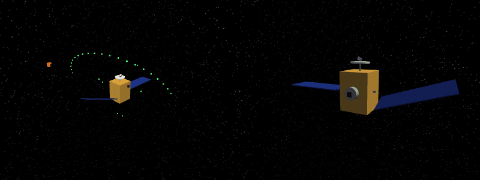
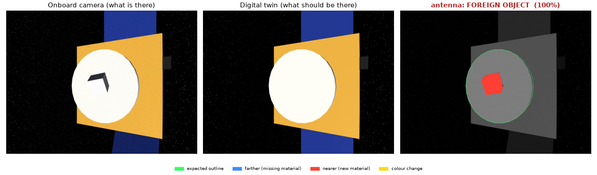
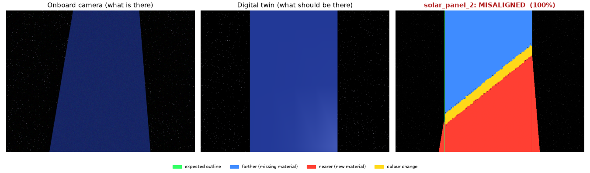
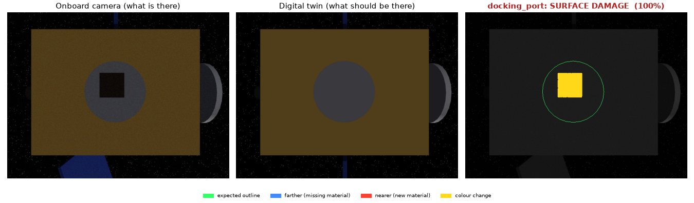
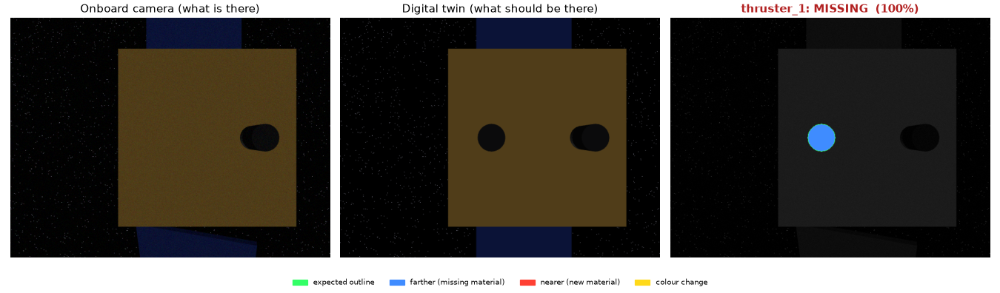

# space-autonomy

A simulation and evaluation testbed for autonomous space robots, starting with one job:
**a free-flying robot inspecting a spacecraft and finding what's wrong with it.**



*Left: the inspector (orange cube) flying its route around the target spacecraft Alpha-03. Right: what its onboard camera sees.
This spacecraft has 4 hidden faults; the robot finds all of them.*

The long-term question this project is built to answer is not "can a robot fly a route?" but
**"how does an autonomous system behave when the world stops behaving as expected?"** —
damaged spacecraft, sensor failures, unexpected obstacles, thruster faults. That needs
three things working together: a simulated environment, an autonomy stack, and an
evaluation harness that measures what actually happened.

## Status

| Milestone | What | State |
|---|---|---|
| M0 | MuJoCo installed, physics + rendering verified | ✅ |
| M1 | 6-DOF free-flyer flies itself to position + attitude targets | ✅ |
| M2–M5 | Target spacecraft (Alpha-03), onboard camera, fixed inspection route | ✅ |
| M6 | Anomaly detection: missing, misaligned, foreign object, surface damage | ✅ |
| M10–M11 | Randomised missions + batch scoring | ✅ (early: anomalies only) |
| M7 | Decide what to inspect next from what's still uncertain | next |
| M8–M9 | Unexpected obstacle, autonomous recovery | |
| M12+ | Learned perception / planning, ROS 2, Isaac Sim | |

## M6 result: anomaly detection

The robot is told what Alpha-03 *should* look like. The simulator builds a damaged copy with
1–3 hidden faults per mission, drawn at random. The robot flies its route, takes an RGB-D
picture at each component, and reports what it thinks is wrong.

**Evaluated on 100 randomised missions it had never seen (seeds 2000–2099), plus one undamaged spacecraft:**

| Metric | Result |
|---|---|
| Anomalies found | **197 / 197** |
| ... with the correct type | 197 / 197 |
| False alarms | 0 in 510 checks of healthy components |
| Missions completed / with a collision | 101 / 0 |
| Mean mission time, propellant | 288 s, 42% |

| Anomaly type | Injected | Found | Correct type |
|---|---|---|---|
| foreign object (debris stuck on a component) | 51 | 51 | 51 |
| misaligned (rotated 20–30°) | 63 | 63 | 63 |
| missing component | 69 | 69 | 69 |
| surface damage (scorch mark) | 14 | 14 | 14 |

On the development seeds (1000–1099) it scored 207/207 found, 206 with the right type
(a 20° star-tracker tilt read as debris). **Read these numbers as a ceiling, not a claim**: see
[why it's this easy right now](#why-100-is-the-wrong-takeaway).

What the robot sees (left), what it expected (middle), and how it explains the difference (right):






In the last image, the twin shows a straight solar panel at the bottom and the camera shows a tilted
one — a fault on a *different* component. It is correctly not blamed on the thruster.

### How the detector works

It's change detection against a **digital twin**, no machine learning:

1. At each stop, the robot takes an RGB + depth image (like Astrobee's colour camera + time-of-flight sensor).
2. It renders the *nominal* spacecraft model from its own pose: what it should be seeing.
3. Per pixel, it compares depth and colour:
   - **farther** than expected → material that should be there is gone
   - **nearer** than expected → something is there that shouldn't be
   - **same depth, different colour** → the surface itself changed
4. The mix decides the verdict: mostly *farther* = **missing**; *farther + nearer* = **misaligned**
   (it moved: one place vacated, another occupied); only *nearer* = **foreign object**; only
   *colour* = **surface damage**.
5. **Credit assignment:** new material only counts against a component if it's connected to it in the
   image. Without this rule, the first version raised 19 false alarms in 100 missions, all from tilted
   solar panels poking into other components' camera views.

The result goes into a **world model**: the robot's belief about every component.

```
WORLD MODEL: Alpha-03
Component       State           Finding          Confidence
───────────────────────────────────────────────────────────
star_tracker    nominal         -                      1.00
solar_panel_1   nominal         -                      1.00
antenna         anomaly         foreign_object         1.00
solar_panel_2   anomaly         misaligned             1.00
docking_port    anomaly         surface_damage         1.00
thruster_2      nominal         -                      1.00
thruster_1      anomaly         missing                1.00
```

### Why 100% is the wrong takeaway

The detector is perfect here because the problem is currently easy in three specific ways, each
of which is a planned next step:

- **The robot knows its exact pose.** The twin image lines up pixel-for-pixel with the real one.
  With realistic navigation error (a few cm, a degree), every edge in the image becomes a "change".
  This is the single biggest weakness of model-based detection and the main reason to move to
  learned perception later.
- **Lighting is identical** between the twin and reality. Real sun angles, glare and shadows differ.
- **Anomalies are clean geometry.** Real damage is subtle: a frayed blanket, a hairline crack.

So these numbers mark the top of the scale. The useful experiment comes next: add pose
noise, lighting changes and subtler faults, and measure how fast performance falls.

## Quick start

macOS / Linux, Python 3.10+:

```bash
python3 -m venv .venv
source .venv/bin/activate
pip install -e ".[dev]"

python scripts/m0_smoke.py                   # is MuJoCo working?
python scripts/m1_goto.py                    # free-flyer flies to 4 pose targets
python scripts/run_mission.py --showcase     # one anomaly of each type -> results/alpha03-showcase/
python scripts/run_mission.py --seed 7       # a random damaged spacecraft
python scripts/run_mission.py --clean        # undamaged spacecraft
python scripts/batch_eval.py --runs 100      # many random missions -> results/batch/summary.md
mjpython scripts/run_mission.py --viewer     # watch live (macOS needs `mjpython`, installed with MuJoCo)
pytest
```

Every mission run writes `telemetry.csv`, `events.json`, `summary.json`, `report.txt`,
`world_model.txt`, plots, and a diagnostic image per inspection (`views/`) to `results/<mission>/`.

## How it works

```
             ┌───────────────────────────── InspectionAgent ─────────────────────────────┐
RobotState ─▶│ LegSequencer ─▶ PoseController ─▶ Wrench        (where to go, how to get there) │─▶ Wrench
Observation ▶│ ChangeDetector(image vs. digital twin) ─▶ WorldModel  (what's wrong)          │
             └─────────────────────────────────────────────────────────────────────────────┘
     ▲                                                                                     │
     │        ┌──────────────────────────── simulator (MuJoCo) ──────────────────────────┐ │
     └─────── │ free-flying body ◀── thrusters    damaged spacecraft    RGB-D camera + noise│◀┘
              └──────────────────────────────────────────────────────────────────────────┘
                     ▲ the harness runs this loop at 20 Hz and records ground truth ▲
```

**The one architectural rule:** the autonomy never reads the simulator's state. It receives
a `RobotState` and camera `Observation`s and returns a `Wrench` (thruster force and torque).
That contract lives in [`core/types.py`](space_autonomy/core/types.py). Porting to Isaac Sim,
ROS 2 or hardware means re-implementing only the simulator side. (The digital twin uses MuJoCo
too, but only as a renderer for the *nominal* model; any renderer would do.)

### The pieces

| Module | What it does |
|---|---|
| [`sim/world.py`](space_autonomy/sim/world.py) | MuJoCo scene: zero gravity, a starfield, a sun, the spacecraft, and the robot (a 10 kg, 0.3 m cube on a free joint, with a camera on its +x face). |
| [`sim/thrusters.py`](space_autonomy/sim/thrusters.py) | Caps force at 1 N and torque at 0.1 N·m per axis; burns propellant at `thrust / (Isp · g0)` with cold-gas Isp = 60 s. |
| [`sim/spacecraft.py`](space_autonomy/sim/spacecraft.py) | A spacecraft is a list of primitive components. The same list generates the MuJoCo geometry *and* the obstacles + inspection targets the autonomy plans with. |
| [`sim/anomalies.py`](space_autonomy/sim/anomalies.py) | Damages a spacecraft: removes, tilts, sticks debris on, or scorches components. Keeps the ground truth. |
| [`sim/sensors.py`](space_autonomy/sim/sensors.py) | RGB-D camera with Gaussian noise (2% colour, 5 mm depth). |
| [`controllers/pose_controller.py`](space_autonomy/controllers/pose_controller.py) | Cascaded controller: position error → desired velocity (capped at 0.25 m/s) → force. Same idea for attitude. |
| [`planning/paths.py`](space_autonomy/planning/paths.py) | Fly straight if it's safe; otherwise back out to a keep-out sphere, go around it, come back in. |
| [`planning/sequencer.py`](space_autonomy/planning/sequencer.py) | Executes legs: fly through waypoints, settle, point the camera, hold, next. |
| [`perception/reference.py`](space_autonomy/perception/reference.py) | Digital twin: renders the nominal spacecraft from the robot's pose (colour, depth, which-component-is-where). |
| [`perception/change_detection.py`](space_autonomy/perception/change_detection.py) | Compares the real and expected images and names the anomaly. |
| [`autonomy/agent.py`](space_autonomy/autonomy/agent.py), [`world_model.py`](space_autonomy/autonomy/world_model.py) | Ties planning, control and perception together; keeps the robot's beliefs. |
| [`evaluation/`](space_autonomy/evaluation/) | Mission harness, anomaly scoring, reports, plots. |

### Key ideas (in plain terms)

- **Relative frame, not orbits.** The target spacecraft is the fixed origin; we simulate only
  the few metres around it. Over a 5-minute inspection at a few metres' range, orbital effects
  (Clohessy-Wiltshire drift) are small next to thruster forces. They're a planned
  realism upgrade, not a starting point.
- **Free-flyer = 6 degrees of freedom.** Three for position, three for orientation. Nothing
  stops the robot except its own thrusters, so every metre of motion costs propellant twice:
  once to speed up, once to stop.
- **Cascaded control.** With 1 N on 10 kg the robot can't brake fast, so the controller caps the
  *speed* it asks for, and the robot never carries more momentum than it can kill.
- **Keep-out sphere.** Borrowed from real proximity operations: only get close to the target along
  known corridors. Conservative and fuel-hungry, which leaves room for smarter planners to win.
- **Digital twin.** If you know what something should look like and exactly where you are, every
  difference is information. The hard part, deliberately not solved yet, is when you don't know exactly where you are.

### Known simplifications (on purpose, for now)

- Perfect state knowledge (see above). Noisy navigation comes next.
- Ideal thrusters: instant response, no misalignment, constant mass.
- The planner plans around the *nominal* spacecraft, so it doesn't know about a tilted panel or debris.
  With damage, worst-case clearance drops from 0.45 m to 0.32 m. That's safe, but only by luck,
  and it's exactly the M8 problem.
- Each component is judged from a single view; confidences are heuristic, not calibrated.

## Repository layout

```
space_autonomy/
  core/          shared types, rotations, geometry
  sim/           MuJoCo world, thrusters, spacecraft builder, anomalies, sensors, rendering
  controllers/   pose controller
  planning/      paths, leg sequencer, fixed-route inspection planner
  perception/    digital twin + change detection
  autonomy/      inspection agent, world model
  evaluation/    mission harness, anomaly scoring, reports, plots
  scenarios/     Alpha-03 spacecraft + scenarios (nominal, random anomalies, showcase)
scripts/         m0_smoke, m1_goto, run_mission, batch_eval
tests/           rotations, control, perception, full missions
docs/media/      images used in this README
results/         run outputs (git-ignored)
```

## What's next

1. **Stress the perception:** add navigation noise and lighting variation to the batch evaluation
   and plot detection rate against noise level. This is the first real "how does it degrade" curve.
2. **M7, active inspection:** when a verdict is uncertain, choose another viewpoint instead of moving on.
3. **M8/M9, unexpected obstacle and recovery:** debris drifts into the path; the robot stops, re-plans and still finishes.
