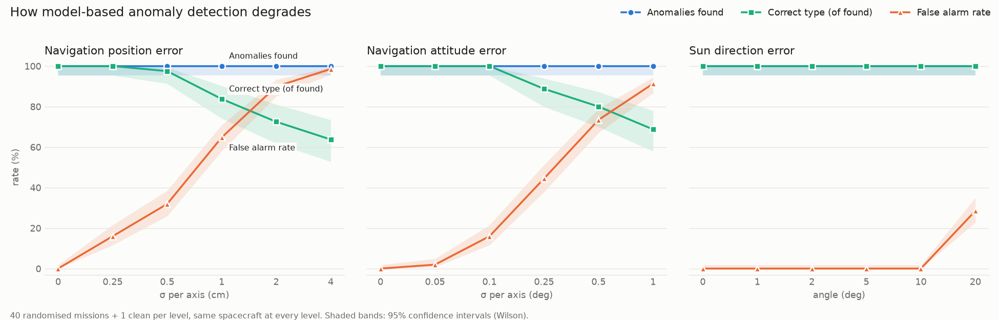
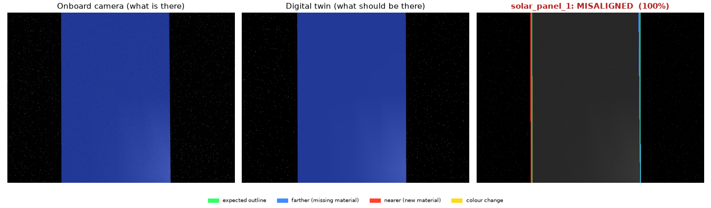
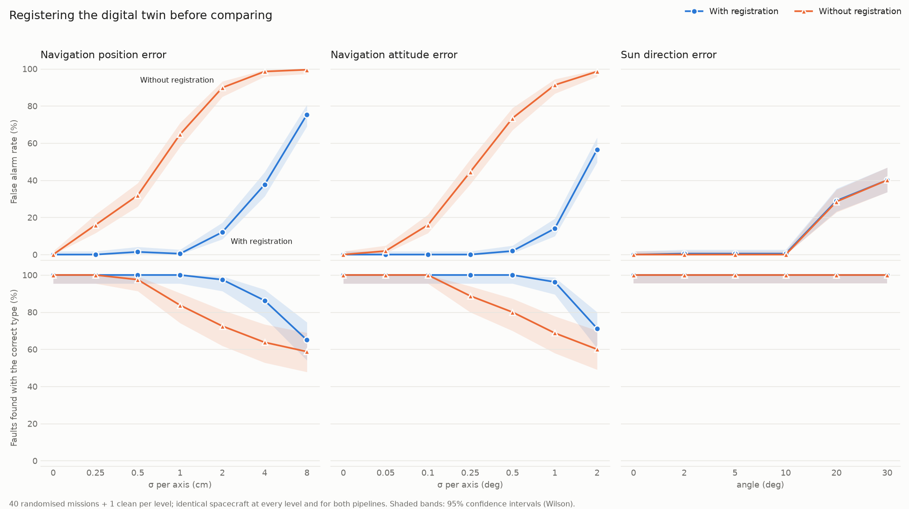
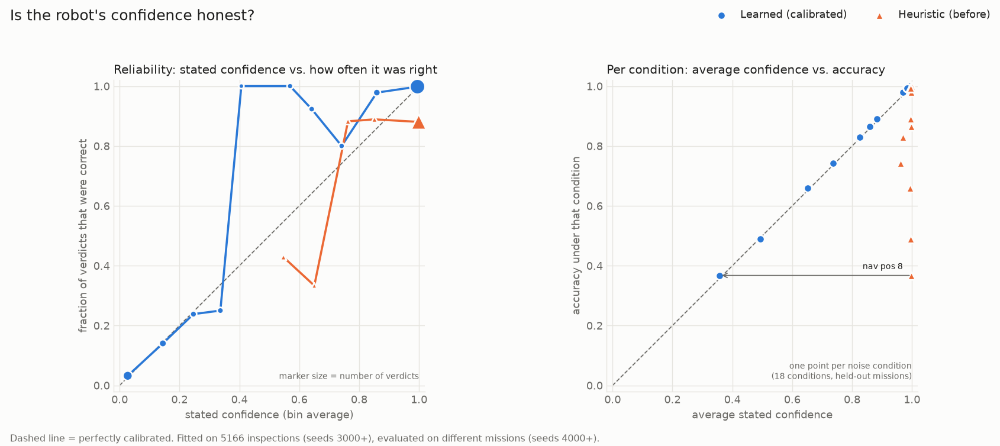

# space-autonomy

A simulation and evaluation testbed for autonomous space robots, starting with one job:
**a free-flying robot inspecting a spacecraft and finding what's wrong with it.**


*Left: the inspector (orange cube) flying its route around the target spacecraft Alpha-03. Right: what its onboard camera sees.
This spacecraft has 4 hidden faults; the robot finds all of them.*

The long-term question this project is built to answer is not "can a robot fly a route?" but
**"how does an autonomous system behave when the world stops behaving as expected?"** —
damaged spacecraft, sensor failures, unexpected obstacles, thruster faults. That needs
three things working together: a simulated environment, an autonomy stack, and an
evaluation harness that measures what actually happened.

## Status

| Milestone | What | State |
|---|---|---|
| M0 | MuJoCo installed, physics + rendering verified | ✅ |
| M1 | 6-DOF free-flyer flies itself to position + attitude targets | ✅ |
| M2–M5 | Target spacecraft (Alpha-03), onboard camera, fixed inspection route | ✅ |
| M6 | Anomaly detection: missing, misaligned, foreign object, surface damage | ✅ |
| M6.1 | Registration: twin aligned to the camera; robust to ~1 cm / 0.5° navigation error | ✅ |
| M6.2 | Calibrated confidence, learned from simulated missions and measured on held-out ones | ✅ |
| M10–M11 | Randomised missions, batch scoring, noise sweep (pose + lighting) | ✅ (early) |
| M7 | Decide what to inspect next from what's still uncertain | next |
| M8–M9 | Unexpected obstacle, autonomous recovery | |
| M12+ | Learned perception / planning, ROS 2, Isaac Sim | |

## M6 result: anomaly detection

The robot is told what Alpha-03 *should* look like. The simulator builds a damaged copy with
1–3 hidden faults per mission, drawn at random. The robot flies its route, takes an RGB-D
picture at each component, and reports what it thinks is wrong.

**Evaluated on 100 randomised missions it had never seen (seeds 2000–2099), plus one undamaged spacecraft:**

| Metric | Result |
|---|---|
| Anomalies found | **197 / 197** |
| ... with the correct type | 197 / 197 |
| False alarms | 0 in 510 checks of healthy components |
| Missions completed / with a collision | 101 / 0 |
| Mean mission time, propellant | 288 s, 42% |

| Anomaly type | Injected | Found | Correct type |
|---|---|---|---|
| foreign object (debris stuck on a component) | 51 | 51 | 51 |
| misaligned (rotated 20–30°) | 63 | 63 | 63 |
| missing component | 69 | 69 | 69 |
| surface damage (scorch mark) | 14 | 14 | 14 |

On the development seeds (1000–1099) it scored 207/207 found, 206 with the right type
(a 20° star-tracker tilt read as debris). **Read these numbers as a ceiling, not a claim**: see
[why it's this easy right now](#why-100-is-the-wrong-takeaway).

What the robot sees (left), what it expected (middle), and how it explains the difference (right):


In the last image, the twin shows a straight solar panel at the bottom and the camera shows a tilted
one — a fault on a *different* component. It is correctly not blamed on the thruster.

### How the detector works

It's change detection against a **digital twin**, no machine learning:

1. At each stop, the robot takes an RGB + depth image (like Astrobee's colour camera + time-of-flight sensor).
2. It renders the *nominal* spacecraft model from its own pose: what it should be seeing. Then it lines
   that render up with the real image ([registration](#fix-register-the-twin-before-comparing)), which
   matters as soon as the pose estimate isn't perfect.
3. Per pixel, it compares depth and colour:
   - **farther** than expected → material that should be there is gone
   - **nearer** than expected → something is there that shouldn't be
   - **same depth, different colour** → the surface itself changed
4. The mix decides the verdict: mostly *farther* = **missing**; *farther + nearer* = **misaligned**
   (it moved: one place vacated, another occupied); only *nearer* = **foreign object**; only
   *colour* = **surface damage**.
5. **Credit assignment:** new material only counts against a component if it's connected to it in the
   image. Without this rule, the first version raised 19 false alarms in 100 missions, all from tilted
   solar panels poking into other components' camera views.

The result goes into a **world model**: the robot's belief about every component.

```
WORLD MODEL: Alpha-03
Component       State           Finding          Confidence
───────────────────────────────────────────────────────────
star_tracker    nominal         -                      1.00
solar_panel_1   nominal         -                      1.00
antenna         anomaly         foreign_object         1.00
solar_panel_2   anomaly         misaligned             1.00
docking_port    anomaly         surface_damage         1.00
thruster_2      nominal         -                      1.00
thruster_1      anomaly         missing                1.00
```

### Why 100% is the wrong takeaway

Those results assume the robot knows its exact pose and the twin is lit exactly like reality.
The next experiment measures what happens when those assumptions break.

## Robustness: how detection degrades

Same 40 random damaged spacecraft (plus one undamaged) at every level, sweeping one factor at a time
(656 missions, about 3.5 minutes on an 11-core M3 Pro):



| Condition | False alarms | Mostly reported as |
|---|---|---|
| Perfect knowledge | 0% | - |
| Position error 2.5 mm (σ per axis) | 16% | surface damage |
| Position error 1 cm | 65% | misaligned |
| Attitude error 0.1° | 16% | surface damage |
| Attitude error 0.25° | 44% | misaligned + surface damage |
| Sun direction off by 10° | 0% | - |
| Sun direction off by 20° | 28% | surface damage |

Full table: `results/noise_sweep/summary.md` after running `python scripts/noise_sweep.py`. What the numbers say:

- **Real faults are always found** (blue line at 100%), but that's not a win. Under noise the
  detector flags almost everything, healthy parts included. The false alarm rate is the real story.
- **Pose error is the killer, and the tolerance is tiny.** False alarms start at **millimetres** of
  position error and **a tenth of a degree** of attitude error. With this camera (640 px, 60° view),
  0.1° of rotation, or 2.5 mm of sideways error at 1.5 m, shifts the image by about 0.7 pixels.
  Every sharp edge then becomes a thin strip of "change":

  

  *A healthy solar panel, 0.5° of attitude error: the twin is a few pixels off, so both long edges light up as
  farther (blue) and nearer (red) material. The verdict is "misaligned, 100%", wrong and fully confident.*
- **The failure has a signature.** Small errors produce false *surface damage* (colour edges shift
  first). Larger errors produce false *misaligned* (depth edges split into farther + nearer pairs). That's
  a clue for the fix, not just a symptom.
- **Lighting is a much smaller problem.** Up to 10° of sun error does nothing, because the detector
  leans on depth, which doesn't care about light. 20° starts to break colour comparisons.
- **Confidence is not calibrated.** Wrong verdicts come out at 100%. A confidence that doesn't drop
  when the robot is wrong can't drive "look again" decisions (M7). Fixed [below](#calibrated-confidence).
- **Safety is unaffected** at these levels: 0 collisions in all 656 missions.

For scale: navigation good to millimetres and hundredths of a degree at a few metres is far
beyond what a small inspector can be expected to have. Pixel-by-pixel comparison against an
unaligned twin only works in simulation, which is what the next section fixes.

## Fix: register the twin before comparing

If the images don't line up, line them up first. Registration runs at every inspection stop,
before the comparison, in two stages:

1. **3D (depth ICP):** the depth image and the twin's depth are the same surface seen from two
   slightly different places. Point-to-plane ICP finds the small rigid motion between them, which *is*
   the navigation error as the camera sees it. The twin is re-rendered from the corrected pose.
2. **2D (image alignment):** depth can't see sliding along a flat surface or spinning about its normal,
   so a solar panel filling the view can stay a few pixels off. Its *outline* can see that motion:
   Lucas–Kanade aligns the twin's picture (brightness + silhouette) to the camera's, with sub-pixel shift and rotation.

Guards so alignment can't explain away a real fault:
- the worst-fitting 20% of points, and robustly down-weighted pixels, don't steer the fit;
- the 3D fit is coarse-to-fine: matches may be 15 cm apart at first but only 2 cm by the end, so the gap a
  missing part leaves can't drag the answer (this was a real bug: a missing thruster pulled the fit 4 cm and
  got the healthy thruster next to it flagged);
- corrections bigger than plausible navigation error (10 cm, 3°, 8 px) are rejected, and if the 2D stage
  rejects its correction after a 3D correction, the 3D one is thrown out too.

Tests check every fault type is still detected after registration.

Same sweep, both pipelines, identical spacecraft (1,476 missions):



| Navigation error | False alarms without registration | False alarms with registration | Faults correctly typed (without → with) |
|---|---|---|---|
| Position 0.5 cm | 32% | 1% | 98% → 100% |
| Position 1 cm | 65% | **0%** | 84% → 100% |
| Position 2 cm | 90% | 12% | 72% → 98% |
| Attitude 0.25° | 44% | **0%** | 89% → 100% |
| Attitude 0.5° | 73% | **2%** | 80% → 100% |
| Attitude 1° | 91% | 14% | 69% → 96% |

- **Tolerance went up roughly 5–10×.** To keep false alarms at a few percent, the detector used to need
  under 2.5 mm and about 0.05° of navigation accuracy. With registration it holds to about 1 cm and 0.5°.
- **Registration also measures the navigation error.** At 0.5° attitude error (median 0.72° per view),
  the registered pose is off by a median 0.11°. At 1 cm position error (median 1.55 cm), it's off by 0.31 cm.
  The spacecraft itself becomes a navigation reference, a first step toward model-based relative navigation.
- **It still breaks, and the sweep shows where.** At 4–8 cm or 2°, more and more corrections exceed the
  plausibility bounds and get rejected (image alignment accepted on only 39–44% of views at the worst levels),
  so the unaligned comparison comes back. That's the guard doing its job; bigger errors need a coarse
  global search first.
- **It does nothing for lighting**, as expected: sun error is a shading problem, not an alignment problem.
  Both pipelines start false-alarming at 20°. That's next in line for the colour comparison.
- **Cost:** about 0.35 s of extra compute per inspection view (a second render + both alignment stages),
  roughly 4× slower missions in the batch runner.

## Calibrated confidence

A confidence is *calibrated* if, of all the verdicts reported at 80%, about 80% are right. The original
heuristic wasn't: it said ~100% whenever enough pixels changed, including when those pixels were
misregistration strips. A robot that's always sure can't decide when to look again.

The simulator gives labelled data for free (every inspection comes with the true answer), so the
confidence is **learned**: one small logistic regression per verdict type, predicting *P(verdict is
correct)* from things the robot can observe:

- **Evidence size:** pixels that got farther, nearer or changed colour, relative to the detection threshold.
- **Evidence shape:** what share of the change lies on edges the twin predicts, and how thick the thickest
  changed region is. Misregistration leaves thin strips along edges (65% on edges, 2 px thick, in a typical
  case); real faults leave solid blobs (≤16% on edges, ≥27 px thick).
- **Registration quality:** whether each alignment stage was accepted, how well the 3D fit converged,
  how big a correction it needed, and whether the stages disagreed.

Fitted on 5,166 inspections from the noise sweep (seeds 3000+), measured on 2,646 inspections from
**different missions** (seeds 4000+):



| Metric | Heuristic (before) | Learned |
|---|---|---|
| Expected calibration error (avg. gap between stated confidence and accuracy) | 0.119 | **0.009** |
| Brier score (lower is better) | 0.120 | **0.012** |
| AUROC: does confidence rank right verdicts above wrong ones? (0.5 = no) | 0.565 | **0.997** |
| Average confidence vs. actual accuracy | 0.99 vs. 0.88 | **0.87 vs. 0.88** |
| Verdicts at ≥ 90% confidence: share, and how often right | 98%, 88% right | 84%, **99.8% right** |

The right panel is the useful view. Under each noise condition, the old confidence stays near 100% while
accuracy drops as low as 37%. The learned confidence drops *with* it, so the robot's average confidence
under a condition now tells you how much to trust it under that condition.

**Does it hold up under conditions it wasn't trained on?** Train with one kind of noise left out entirely,
test only on that kind:

| Left out of training | Calibration error: heuristic → learned | AUROC learned |
|---|---|---|
| Navigation position error | 0.179 → **0.037** | 0.958 |
| Navigation attitude error | 0.110 → **0.021** | 0.996 |
| Sun direction error | 0.082 → 0.076 | 0.747 |

Position and attitude error transfer to each other: both cause misregistration, which leaves the same
thin-strip signature. Lighting does not: its false alarms look different, and a model that has never seen
one can't recognise one. **A learned confidence is only as honest as the failure modes in its training
data.** That's the strongest argument yet for this project's premise. You can't trust a robot's
sense of its own reliability without systematically testing the conditions it will meet.

Caveats: the "nominal" verdict was never wrong in training (every injected fault was found), so the model
trusts it at ~100%. That's fine for these faults but would be overconfident against subtler ones. The
middle confidence bins in the reliability plot hold few verdicts, so they're noisy.

## Quick start

macOS / Linux, Python 3.10+:

```bash
python3 -m venv .venv
source .venv/bin/activate
pip install -e ".[dev]"

python scripts/m0_smoke.py                   # is MuJoCo working?
python scripts/m1_goto.py                    # free-flyer flies to 4 pose targets
python scripts/run_mission.py --showcase     # one anomaly of each type -> results/alpha03-showcase/
python scripts/run_mission.py --seed 7       # a random damaged spacecraft
python scripts/run_mission.py --clean        # undamaged spacecraft
python scripts/batch_eval.py --runs 100      # many random missions -> results/batch/summary.md
python scripts/batch_eval.py --runs 100 --nav-att-deg 0.25   # ...with navigation error (also --nav-pos-cm, --sun-deg)
python scripts/noise_sweep.py                # degradation curves, with vs without registration (~18 min)
python scripts/calibrate.py                  # refit + measure the confidence model (needs two sweeps; see the script)
python scripts/run_mission.py --showcase --nav-att-deg 0.5 --no-registration   # see what a false alarm looks like
mjpython scripts/run_mission.py --viewer     # watch live (macOS needs `mjpython`, installed with MuJoCo)
pytest
```

Every mission run writes `telemetry.csv`, `events.json`, `summary.json`, `report.txt`,
`world_model.txt`, plots, and a diagnostic image per inspection (`views/`) to `results/<mission>/`.

## How it works

```
             ┌───────────────────────────── InspectionAgent ─────────────────────────────┐
RobotState ─▶│ LegSequencer ─▶ PoseController ─▶ Wrench        (where to go, how to get there) │─▶ Wrench
Observation ▶│ ChangeDetector(image vs. digital twin) ─▶ WorldModel  (what's wrong)          │
             └─────────────────────────────────────────────────────────────────────────────┘
     ▲                                                                                     │
     │        ┌──────────────────────────── simulator (MuJoCo) ──────────────────────────┐ │
     └─────── │ free-flying body ◀── thrusters    damaged spacecraft    RGB-D camera + noise│◀┘
              └──────────────────────────────────────────────────────────────────────────┘
                     ▲ the harness runs this loop at 20 Hz and records ground truth ▲
```

**The one architectural rule:** the autonomy never reads the simulator's state. It receives
a `RobotState` and camera `Observation`s and returns a `Wrench` (thruster force and torque).
That contract lives in [`core/types.py`](space_autonomy/core/types.py). Porting to Isaac Sim,
ROS 2 or hardware means re-implementing only the simulator side. (The digital twin uses MuJoCo
too, but only as a renderer for the *nominal* model; any renderer would do.)

### The pieces

| Module | What it does |
|---|---|
| [`sim/world.py`](space_autonomy/sim/world.py) | MuJoCo scene: zero gravity, a starfield, a sun, the spacecraft, and the robot (a 10 kg, 0.3 m cube on a free joint, with a camera on its +x face). |
| [`sim/thrusters.py`](space_autonomy/sim/thrusters.py) | Caps force at 1 N and torque at 0.1 N·m per axis; burns propellant at `thrust / (Isp · g0)` with cold-gas Isp = 60 s. |
| [`sim/spacecraft.py`](space_autonomy/sim/spacecraft.py) | A spacecraft is a list of primitive components. The same list generates the MuJoCo geometry *and* the obstacles + inspection targets the autonomy plans with. |
| [`sim/anomalies.py`](space_autonomy/sim/anomalies.py) | Damages a spacecraft: removes, tilts, sticks debris on, or scorches components. Keeps the ground truth. |
| [`sim/sensors.py`](space_autonomy/sim/sensors.py) | RGB-D camera with Gaussian noise (2% colour, 5 mm depth); slowly drifting navigation error. |
| [`scenarios/conditions.py`](space_autonomy/scenarios/conditions.py) | How far reality departs from the robot's assumptions: navigation error, sun-direction error. |
| [`controllers/pose_controller.py`](space_autonomy/controllers/pose_controller.py) | Cascaded controller: position error → desired velocity (capped at 0.25 m/s) → force. Same idea for attitude. |
| [`planning/paths.py`](space_autonomy/planning/paths.py) | Fly straight if it's safe; otherwise back out to a keep-out sphere, go around it, come back in. |
| [`planning/sequencer.py`](space_autonomy/planning/sequencer.py) | Executes legs: fly through waypoints, settle, point the camera, hold, next. |
| [`perception/reference.py`](space_autonomy/perception/reference.py) | Digital twin: renders the nominal spacecraft from the robot's pose (colour, depth, which-component-is-where). |
| [`perception/registration.py`](space_autonomy/perception/registration.py) | Lines the twin up with the camera: point-to-plane ICP on depth, then Lucas–Kanade on the image. |
| [`perception/change_detection.py`](space_autonomy/perception/change_detection.py) | Compares the real and expected images and names the anomaly. |
| [`perception/calibration.py`](space_autonomy/perception/calibration.py) | Learned confidence (per-verdict logistic regression) and calibration metrics; the trained model ships as `confidence_model.json`. |
| [`autonomy/agent.py`](space_autonomy/autonomy/agent.py), [`world_model.py`](space_autonomy/autonomy/world_model.py) | Ties planning, control and perception together; keeps the robot's beliefs. |
| [`evaluation/`](space_autonomy/evaluation/) | Mission harness, anomaly scoring, parallel batch runner with confidence intervals, reports, plots. |

### Key ideas (in plain terms)

- **Relative frame, not orbits.** The target spacecraft is the fixed origin; we simulate only
  the few metres around it. Over a 5-minute inspection at a few metres' range, orbital effects
  (Clohessy-Wiltshire drift) are small next to thruster forces. They're a planned
  realism upgrade, not a starting point.
- **Free-flyer = 6 degrees of freedom.** Three for position, three for orientation. Nothing
  stops the robot except its own thrusters, so every metre of motion costs propellant twice:
  once to speed up, once to stop.
- **Cascaded control.** With 1 N on 10 kg the robot can't brake fast, so the controller caps the
  *speed* it asks for, and the robot never carries more momentum than it can kill.
- **Keep-out sphere.** Borrowed from real proximity operations: only get close to the target along
  known corridors. Conservative and fuel-hungry, which leaves room for smarter planners to win.
- **Digital twin.** If you know what something should look like and exactly where you are, every
  difference is information. The hard part, deliberately not solved yet, is when you don't know exactly where you are.

### Known simplifications (on purpose, for now)

- Navigation error is modelled as a drifting offset on the robot's estimate, not as a real
  estimator (no visual odometry or filter yet). Off by default; the noise sweep turns it on.
- Ideal thrusters: instant response, no misalignment, constant mass.
- The planner plans around the *nominal* spacecraft, so it doesn't know about a tilted panel or debris.
  With damage, worst-case clearance drops from 0.45 m to 0.32 m. That's safe, but only by luck,
  and it's exactly the M8 problem.
- Each component is judged from a single view.
- The confidence model only knows the failure modes it was trained on (see the lighting result), and a
  "nominal" verdict was never wrong in training, so it is currently trusted almost completely.
- Registration corrects the pose used for *perception only*; it isn't fed back into navigation yet.

## Repository layout

```
space_autonomy/
  core/          shared types, rotations, geometry
  sim/           MuJoCo world, thrusters, spacecraft builder, anomalies, sensors, rendering
  controllers/   pose controller
  planning/      paths, leg sequencer, fixed-route inspection planner
  perception/    digital twin + change detection
  autonomy/      inspection agent, world model
  evaluation/    mission harness, anomaly scoring, reports, plots
  scenarios/     Alpha-03 spacecraft + scenarios (nominal, random anomalies, showcase)
scripts/         m0_smoke, m1_goto, run_mission, batch_eval, noise_sweep, calibrate
tests/           rotations, control, perception, full missions
docs/media/      images used in this README
results/         run outputs (git-ignored)
```

## What's next

1. **M7, active inspection:** the confidence is now honest, so use it. Below a threshold, go and look again
   from a different viewpoint instead of reporting. On the held-out data, the verdicts under 90% confidence were
   right only 24% of the time, so they're exactly the ones worth a second look.
2. **Lighting-robust comparison:** compare shading-invariant features (or relight the twin) so sun error stops
   causing false surface damage, and add lighting faults to the confidence model's training data.
3. **Subtler faults:** smaller debris, partial damage, so that "nominal" verdicts can be wrong and the confidence
   model learns when to doubt them.
4. **M8/M9, unexpected obstacle and recovery:** debris drifts into the path; the robot stops, re-plans and still finishes.
